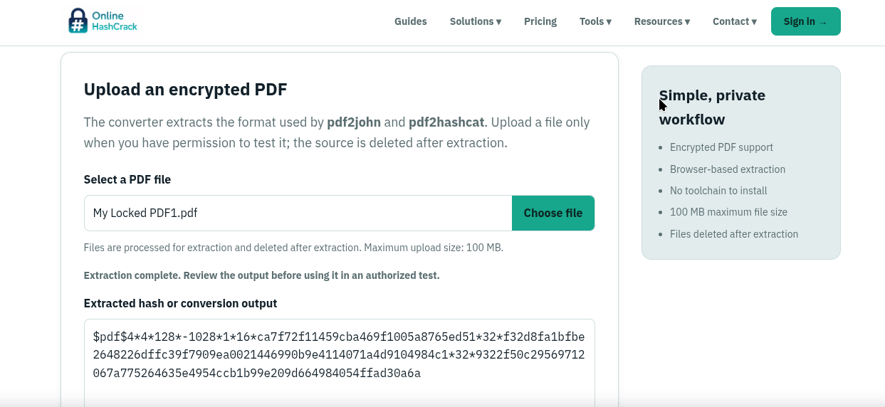
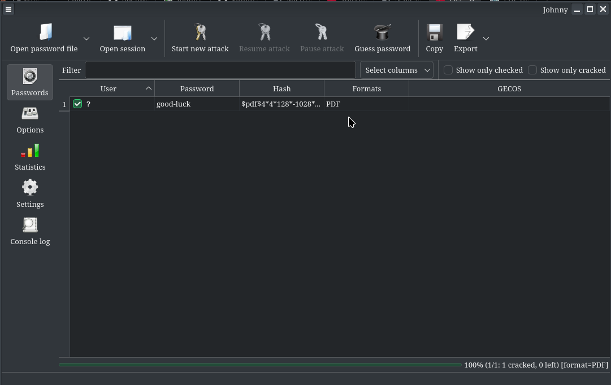
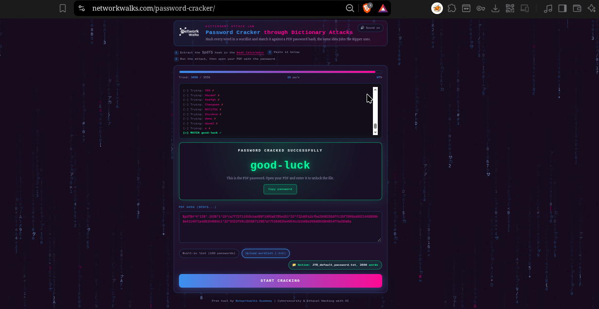
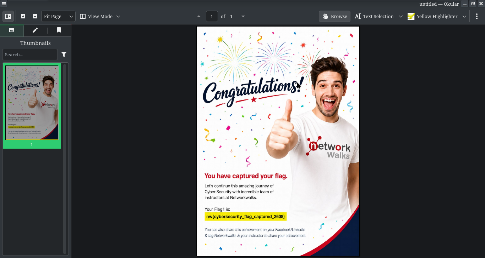
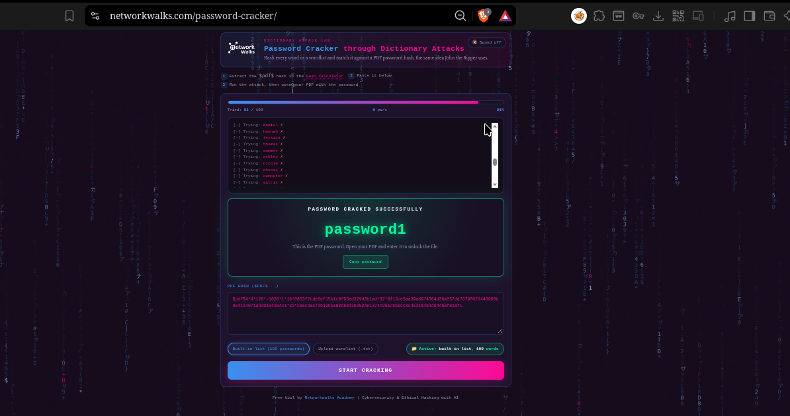
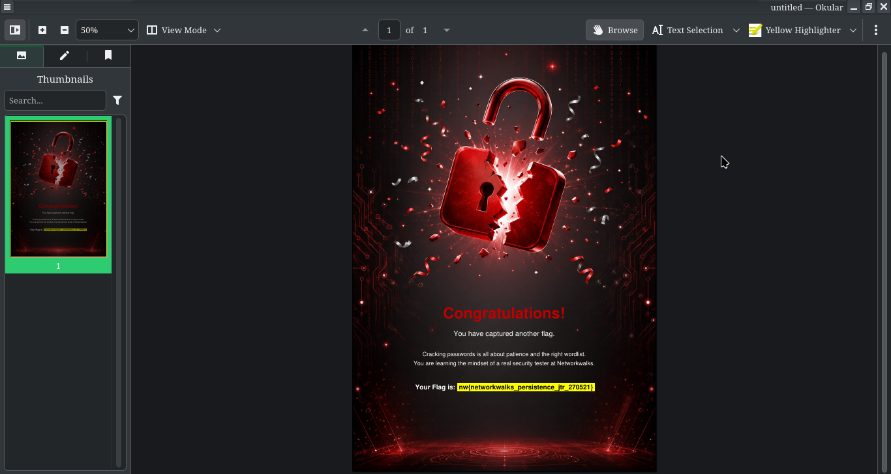
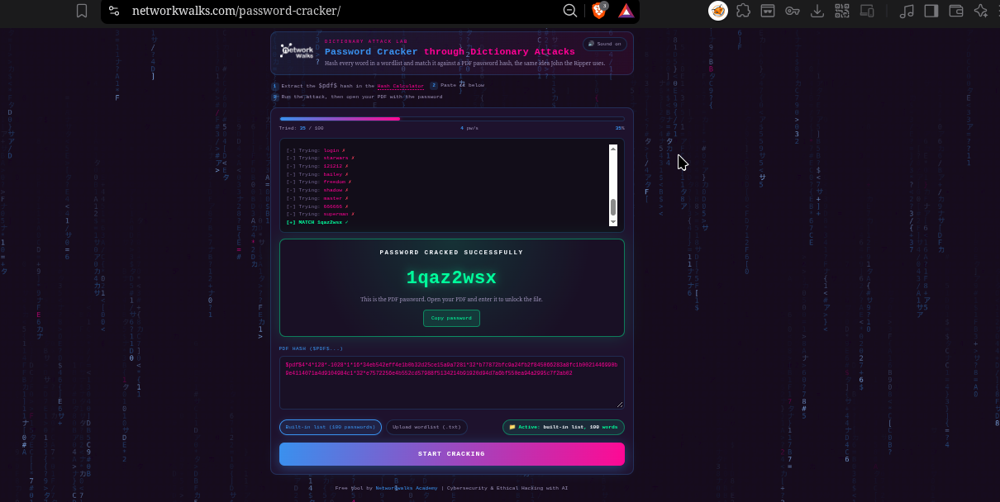
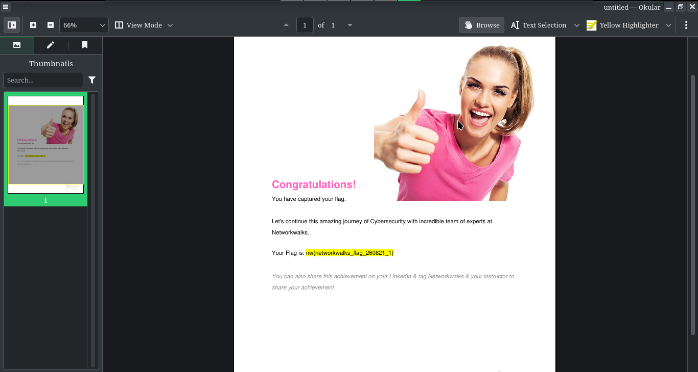

# NETWORKWALKS-S4NTRX_BO84-WK3-PM1-PM2-PASSWORD-CRACKING

# NetworkWalks — Password Cracking with JTR & NetworkWalks Tools

**Program:** Cybersecurity & Ethical Hacking Project Work — Project Modules PM1 & PM2
**Student:** s4ntrx
**Tools:** John the Ripper (Johnny GUI), Online HashCrack (pdf2john extraction), NetworkWalks Password Cracker

---

## Objective

Three password-protected PDF files were supplied as locked targets. The task was to:

1. **PM1 — Password Cracking with JTR:** extract the PDF's hash and recover the password using John the Ripper (via the Johnny GUI).
2. **PM2 — Password Cracking with NetworkWalks Tools:** recover the password using NetworkWalks' browser-based Password Cracker, and use it to work through the remaining locked files.

Each recovered PDF contained a congratulations page with a capture flag, confirming a successful crack.

---

## Methodology

1. **Extract the hash** — each locked PDF was uploaded to an online `pdf2john`-style converter (Online HashCrack) to extract its `$pdf$...` hash in John the Ripper format.
2. **Dictionary attack (JTR)** — the extracted hash for PDF 1 was loaded into Johnny (the GUI front-end for John the Ripper) and cracked with a dictionary attack.
3. **Dictionary attack (NetworkWalks tool)** — the same hash workflow was repeated using NetworkWalks' Password Cracker, which runs the identical dictionary-attack logic in-browser. This was used to cross-verify PDF 1's password and to crack PDFs 2 and 3.
4. **Unlock & confirm** — each recovered password was entered into its PDF to unlock it and capture the flag printed inside.

---

## Results

| File | Hash file | Tool(s) used | Cracked password | Captured flag |
|---|---|---|---|---|
| Locked PDF 1 | [`pdf1/hashpdf1.txt`](pdf1/hashpdf1.txt) | John the Ripper (Johnny) + NetworkWalks Password Cracker | `good-luck` | `nw{cybersecurity_flag_captured_2608}` |
| Locked PDF 2 | [`pdf2/hashpdf2.txt`](pdf2/hashpdf2.txt) | John the Ripper (Johnny) + NetworkWalks Password Cracker | `password1` | `nw{networkwalks_persistence_jtr_270521}` |
| Locked PDF 3 | [`pdf3/hashpdf3.txt`](pdf3/hashpdf3.txt) | John the Ripper (Johnny) + NetworkWalks Password Cracker | `1qaz2wsx` | `nw{networkwalks_flag_260821_1}` |

---

## PM1 — Password Cracking with JTR (Locked PDF 1)

**Step 1 — Extract the hash**

Locked PDF 1 was uploaded to Online HashCrack's converter to extract the `$pdf$` hash used by `pdf2john`/`pdf2hashcat`.

**Step 2 — Crack with Johnny (John the Ripper)**

The extracted hash was loaded into Johnny and cracked via dictionary attack, recovering the password `good-luck`.

**Step 3 — Cross-check with the NetworkWalks tool**

The same hash was run through the NetworkWalks Password Cracker as a cross-check, returning the identical password.

**Step 4 — Captured flag**

> **Flag:** `nw{cybersecurity_flag_captured_2608}`

---

## PM2 — Password Cracking with NetworkWalks Tools (Locked PDFs 2 & 3)

**Locked PDF 2**

> **Password:** `password1` · **Flag:** `nw{networkwalks_persistence_jtr_270521}`

**Locked PDF 3**

> **Password:** `1qaz2wsx` · **Flag:** `nw{networkwalks_flag_260821_1}`

---

## Key Takeaways

- All three passwords were weak, dictionary-guessable strings (`good-luck`, `password1`, `1qaz2wsx`), which is why a plain dictionary attack cracked each one in seconds without needing brute force or rules.
- Running the same hash through two independent tools (Johnny/JTR and the NetworkWalks cracker) produced matching results, which is a useful sanity check when validating a cracking workflow.
- This reinforces a core password-hygiene lesson: short, common, keyboard-pattern, or "add a number" passwords (`1qaz2wsx`, `password1`) offer almost no real protection against dictionary attacks.

## Ethical Note

All files cracked in this repo were provided for training purposes as part of the NetworkWalks Cybersecurity & Ethical Hacking program. These techniques were applied only to files explicitly supplied for this exercise and should only ever be used on systems/files you own or are authorized to test.

---

**[www.networkwalks.com](https://networkwalks.com)**
